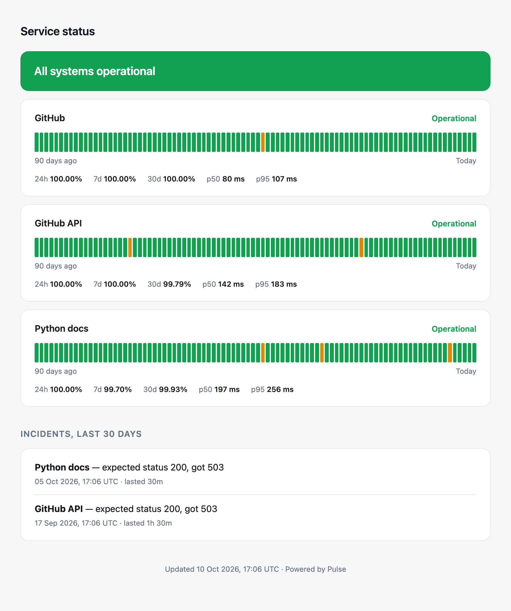

# Pulse

[](https://github.com/mubarak-jimoh/pulse/actions/workflows/ci.yml)

A small uptime monitor you host yourself. It checks your sites on a schedule, records every result, opens an incident when something goes down, alerts you, and serves a public status page.



*The screenshot uses generated demo history (`python -m pulse seed-demo`), not real outage data.*

## What it does

- **Checks** each URL on its own interval. A check passes only if the request finishes inside the timeout, the status code matches, and (optionally) the response contains some expected text.
- **Incidents** open after a set number of failures in a row, so one slow response does not page anyone. One passing check resolves the incident.
- **Alerts** go to a Slack or Discord webhook when an incident opens and when it recovers, including how long the outage lasted.
- **Status page** shows 90 days of daily history, uptime over 24 hours, 7 days and 30 days, and p50 and p95 response times. It is plain server-rendered HTML with no JavaScript, and it follows the visitor's light or dark setting.
- **JSON API and badges** so the same data can be used elsewhere.

## Run it

```bash
python -m venv .venv && source .venv/bin/activate
pip install -e ".[dev]"

cp monitors.example.toml monitors.toml   # then edit it
python -m pulse check                    # check everything once
python -m pulse serve                    # http://127.0.0.1:8000
```

To see the page with history straight away:

```bash
python -m pulse --db demo.db seed-demo
python -m pulse --db demo.db serve
```

### Docker

```bash
docker build -t pulse .
docker run -p 8000:8000 -v "$PWD/monitors.toml:/config/monitors.toml:ro" -v pulse-data:/data pulse
```

## Configuration

```toml
title = "Service status"
failure_threshold = 2            # failures in a row before an incident opens
webhook_url = "https://hooks.slack.com/services/..."   # optional
retention_days = 90

[[monitor]]
name = "API"
url = "https://api.example.com/health"
interval = 60                    # seconds between checks
timeout = 5
expect_status = 200
expect_text = "ok"               # optional
```

Bad config fails at start-up with a message that says what to fix, for example `monitor 'API': interval must be at least 5 seconds`.

## Endpoints

| Path | Returns |
| --- | --- |
| `/` | The status page |
| `/api/status` | Everything on the page as JSON |
| `/api/monitors/{slug}/checks?hours=24` | Raw check results |
| `/badge/{slug}.svg` | A 30-day uptime badge |
| `/healthz` | Liveness check for the monitor itself |

## How it is built

```
config.py     reads and validates monitors.toml
checker.py    makes one HTTP request and decides pass or fail
incidents.py  turns a stream of results into incidents
stats.py      uptime, percentiles and daily buckets
alerts.py     webhook messages
scheduler.py  one asyncio loop per monitor
db.py         SQLite storage
page.py       HTML and SVG rendering
app.py        FastAPI routes
```

A few decisions worth explaining:

- **asyncio, not threads.** A monitor spends nearly all its time waiting on the network. One event loop runs every monitor with a single shared HTTP client, and a slow site cannot hold up the others.
- **No drift.** Each loop sleeps for whatever is left of the interval after the check finishes, so a 60-second monitor runs every 60 seconds even when the check itself takes two.
- **An outage starts at the first failure.** With a threshold of 2, the incident is opened on the second failed check but is dated from the first, which is when the site actually went down.
- **Alerts can never crash the monitor.** A failed webhook is logged and the loop carries on.
- **Time is passed in, not read.** The functions that work with time take `now` as an argument, so the tests use a fixed timestamp and never sleep or patch the clock.
- **SQLite in WAL mode.** One file, no server to run, and the status page can read while the scheduler writes.

## Tests

```bash
pytest -q        # 78 tests, about a second
ruff check .
```

No test touches the network. HTTP is replaced with `httpx.MockTransport`, so timeouts, connection errors, redirects and wrong status codes are all exercised directly.

## Limits

- It checks from one place. If the machine running Pulse loses its connection, everything looks down.
- HTTP and HTTPS only. No ping, TCP or certificate-expiry checks yet.
- The status page has no login, so do not put private URLs in a public instance.

## Licence

MIT
